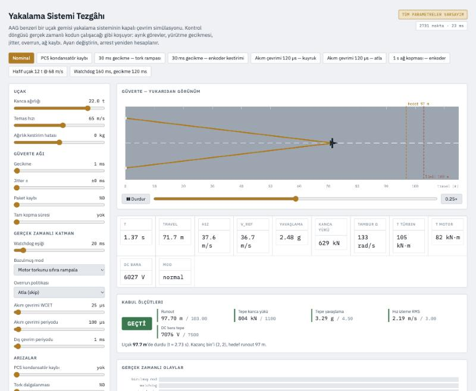
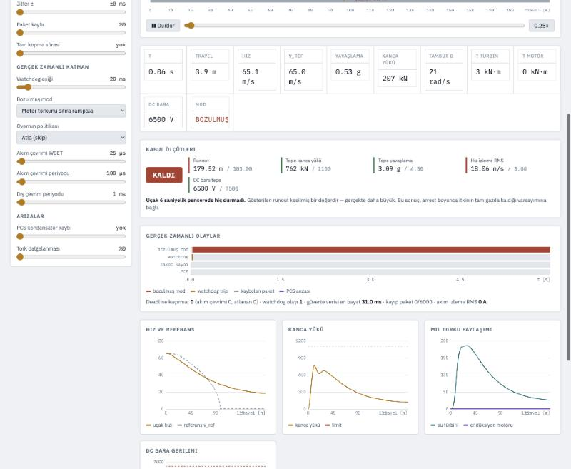

# Uçak Gemisi Yakalama Sistemi Simülasyonu

*Türkçe · [English](README.en.md)*

Bir uçak gemisi **yakalama sisteminin** (arresting gear) kapalı çevrim simülasyonu.
Amaç bir fizik sorusunu değil, bir yazılım sorusunu yanıtlamak:
**gerçek zamanlı davranışın hangi özellikleri gerçekten önemli, hangileri değil?**

Kontrol döngüsü sürekli zamanlı bir idealizasyon olarak çalışmıyor. Gerçek zamanlı kodun
çalıştığı gibi çalışıyor: dört ayrı periyotta dört görev, her birinin kendi yürütme süresi,
jitter'ı ve overrun davranışı var; sensör verisi gecikmeli, jitter'lı ve paket kaybına açık
bir hat üzerinden geliyor. Bunların hepsi enjekte edilebilir ve tohumlu, yani her
"deterministik olmayan" koşu birebir tekrar üretilebiliyor.

Saf Python standart kütüphanesi. **Bağımlılık yok, derleme adımı yok.**

> **Bu sayılar gerçek AAG değerleri değildir.** Model, açık kaynaklarda tarif edilen
> mimariden kuruldu; hiçbir sistem verisi kullanılmadı. [`aag/params.py`](aag/params.py)
> içindeki her sayısal parametre bir varsayımdır ve öyle etiketlenmiştir. Sonuçları bu
> mimarinin *göreli duyarlılıkları* olarak okuyun, gerçek bir sistemin doğrulaması olarak
> değil.



---

## Hızlı başlangıç

```bash
python3 run_arrest.py        # tek arrest, metin raporu + CSV iz kaydı
```

```bash
python3 tests/selfcheck.py   # enerji dengesi, adım yakınsaması, determinizm
```

```bash
python3 run_scenarios.py     # on adlandırılmış arıza senaryosu yan yana
```

```bash
python3 sweeps/sweep_timing.py   # bütün zamanlama/ağ/güç taramaları (~15 dk)
```

Etkileşimli tezgâh için [`ui/simulator.html`](ui/simulator.html) dosyasını tarayıcıda açın —
tek dosya, çevrimdışı çalışır, kurulum gerektirmez.

---

## Ne modelleniyor

```
uçak (m, v) ── güverte pandant geometrisi s(x)=2(√(x²+B²)−B) ── elastik halat
   └─ ağırlığa göre çizelgelenen şok sönümleyici ── tambur (J)
        ├─ su türbini   T = k·ω|ω|        (enerjinin ≈%70'i)
        └─ endüksiyon motoru              (ince kontrol, son durdurma)
              └─ paylaşımlı PCS: DC bara + kondansatör bankası + fren çoperi
```

Halat bosaltımı travel'a göre doğrusal değil; bu yüzden aynı kanca kuvveti koşunun başında
ve sonunda çok farklı halat gerilimi gerektiriyor. Tambur mili hem hidrodinamik bir freni
hem kontrollü bir makineyi taşıyor ve ikisi tek bir paylaşımlı güç koşullandırma sistemini
besliyor.

Kontrol, dört ayrık görev olarak:

| Görev | Periyot | İşi |
|---|---|---|
| `supervisor` | 100 Hz | ağırlık × hız kazanç bin'i, watchdog, bozulmuş mod |
| `trajectory` | 500 Hz | hız referansı `v_ref(x)` |
| `outer` | 1 kHz | mil tork komutu (ileri besleme + PI) |
| `inner` | 10 kHz | motor akım kontrolü (PI) |

Her görev girişini serbest bırakma anında okuyor, çıkışını
`serbest bırakma + yürütme süresi` anında uyguluyor. Bir görevin işleri **sırayla** koşuyor
ve bir iş periyodunu aştığında ne olacağı açık bir politika (`skip` veya `queue`) — ki bu,
yürütme süresinin kendisinden daha belirleyici çıkıyor.

### Nominal çalışma noktası

22 t, 65 m/s: runout **97.7 m**, tepe kanca yükü **804 kN**, tepe yavaşlama **3.29 g**,
hız izleme RMS **2.19 m/s**, su türbini payı **%70.2**, enerji dengesi **%0.000** içinde
kapanıyor ve entegrasyon adımı yarıya indiğinde hiçbir metrik %0.01'den fazla değişmiyor.

---

## Taramalardan çıkanlar

On sekiz tarama, her biri tek bir yolu bozup kabul ölçütlerinin nerede kırıldığını buluyor.
Tam metin: [`docs/rt-work-items.md`](docs/rt-work-items.md).

### 1. Overrun politikası, WCET'ten daha belirleyici

Akım çevrimi, periyot 100 µs sabit, yürütme süresi taranıyor:

| WCET | `queue` (kuyruk) | `skip` (atla) |
|---|---|---|
| 95 µs | 97.7 m · 3.29 g (14 641 kaçırılan deadline) | 97.7 m · 3.29 g |
| **120 µs** | **hiç durmuyor · 8.42 g · 1910 kN** | 97.7 m · 3.29 g |
| 400 µs | 137 m · 5.97 g | 97.7 m · 3.30 g |

Sınırsız bir iş kuyruğunda, yürütme süresi periyodu aştığı anda giriş-çıkış gecikmesi her
işte 20 µs büyüyor ve arrest mekanik hasar seviyesine çıkıyor. "Meşgulse atla" politikasında
4 katlık bir aşım bile nominalden ayırt edilemiyor.

Yani gereksinim "WCET'i küçült" değil, **"overrun politikasını tanımla"**. Kabul kriteri de
"sıfır deadline kaçırma" değil `WCET < periyot` olarak yazılmalı — 95 µs'de çevrim 14 641
deadline kaçırıyor ve hiçbir şey olmuyor.

### 2. Döngü gecikmesi zararsız; bozulmuş mod değil

Watchdog eşiği × ağ gecikmesi, hücre = runout:

```
  wd / lat        0        5       10       20       30       50       80      120   [ms]
         5      98      98* DURMADI* DURMADI* DURMADI* DURMADI* DURMADI* DURMADI*
        20      98      98      98      98* DURMADI* DURMADI* DURMADI* DURMADI*
        80      98      98      98      98      98      98      98* DURMADI*
       160      98      98      98      98      98      98      98      98
```

*(runout metre cinsinden; `DURMADI` = uçak 6 s'lik pencerede hiç durmadı, yani değer
kesilmiş olurdu; `*` = bir kabul ölçütü ihlal edildi. Yedi watchdog satırından dördü.)*

İhlal sınırı tam olarak `gecikme ≥ watchdog eşiği` köşegeni. Watchdog 160 ms'e çekildiğinde
120 ms saf gecikme bile hiçbir şeyi değiştirmiyor — dış çevrim ileri besleme ağırlıklı ve su
türbini güçlü bir pasif geri besleme sağlıyor.

Asıl sorun tripten *sonra* olan. Varsayılan bozulmuş mod motor torkunu sıfıra rampalıyor,
geriye yalnızca türbin kalıyor ve `T ∝ ω²` düşük hızda sabit itkiyi yenemediği için
**uçak hiç durmuyor**:



Bunun yerine konum ve hızı yerel tambur enkoderinden kestirmek (bosaltım geometrisini
tersine çevirerek) çevrimi kapalı tutuyor ve güverte ağına hiç bağlı kalmıyor:

| Tam ağ kopması | tork rampası | enkoder kestirimi |
|---|---|---|
| 400 ms | RMS 3.08 — kaldı | 97.7 m · RMS 2.29 — **geçti** |
| 1000 ms | 107.8 m · 4.60 g — kaldı | 98.4 m · 3.43 g — **geçti** |
| 1500 ms | 119.7 m — kaldı | 98.9 m · RMS 2.78 — **geçti** |

Emniyet yolu ağa bağlı olmaktan çıktığında 1.5 saniyelik tam kesinti bile hiçbir ölçütü
ihlal etmiyor.

### 3. Paylaşımlı güç sistemi, yazılımın kapatamayacağı bir tek nokta arızası

Kondansatör bankasının koşunun *herhangi* bir anında kaybı uçağın durmaması demek
(20 s'de 409 m ve hâlâ hareket hâlinde). Takımdaki koşulsuz başarısız olan tek senaryo bu.
Tespit, kayıt ve iniş öncesi hazırlık kontrolü yazılımın işi; çözüm mimari.

### Ayrıca ölçülenler

±20 ms jitter, %85 paket kaybı, 90 ms tıkanıklık patlamaları, 32 ms dış çevrim periyodu,
%60 tork dalgalanması, 25 Hz'e kadar güverte örnekleme — hiçbiri tek başına tek bir kabul
ölçütünü kırmıyor. Zararı yalnızca watchdog *üzerinden* veriyorlar. Akım çevriminin periyot
sınırı mutlak bir sayı değil, bant genişliğiyle ölçekleniyor (`T·ω_c ≲ 1.5`).

Ağırlık kestirim hatası asimetrik: 4000 kg düşük tahmin kabul ölçütünü kırıyor, 10 000 kg
yüksek tahmin kırmıyor.

---

## Etkileşimli tezgâh

[`ui/simulator.html`](ui/simulator.html) tek başına çalışan bir HTML dosyası: yukarıdan
güverte görünümü (halat ve uçak canlandırılmış), canlı telemetri, kabul ölçütleri, gerçek
zamanlı olay şeridi (bozulmuş mod aralıkları, watchdog tripleri, kaybolan paketler) ve dört
grafik. Her ayar değişiminde arrest yaklaşık 25 ms'de yeniden hesaplanıyor. Dokuz hazır
durum, yukarıdaki bulguları tek tıkla gösteriyor.

Tarayıcı motoru ([`ui/engine.js`](ui/engine.js)) Python modelinin birebir portu.
`node ui/verify.mjs` dokuz yapılandırmayı bu motordan geçiriyor ve sayılar Python modeliyle
durum durum eşleşiyor.

---

## Öz-kontroller

Tarama sonuçları ancak model sağlamsa okunmaya değer, bu yüzden `tests/selfcheck.py` onları
kapıda tutuyor:

- enerji dengesi %1 içinde kapanıyor (şu an %0.000)
- taban adım yarıya indiğinde her metrik %1'den az değişiyor
- aynı tohum aynı sonucu veriyor — **ayrı süreçlerde de**, ki bu gerçek bir hata yakaladı:
  Python'da string `hash()`'i süreçten sürece değiştiği için "deterministik" koşular aslında
  tekrar üretilemiyordu
- hızlı entegrasyon modu ayrıntılı modla %3 içinde uyuşuyor
- su türbini enerjinin %65–75'ini alıyor, elimizdeki tek sayısal hedef

---

## Depo haritası

| Yol | İçerik |
|---|---|
| [`aag/params.py`](aag/params.py) | bütün parametreler, her biri varsayım olarak işaretli |
| [`aag/plant.py`](aag/plant.py) | fizik: uçak, halat geometrisi, şok sönümleyici, tambur, türbin, motor, PCS |
| [`aag/control.py`](aag/control.py) | dört ayrık kontrol görevi, kazanç bin'leri, bozulmuş mod |
| [`aag/rt.py`](aag/rt.py) | gerçek zamanlı zamanlayıcı ve ağ katmanı — gecikme, jitter, overrun, paket kaybı |
| [`aag/sim.py`](aag/sim.py) | orkestrasyon, metrikler, enerji muhasebesi |
| [`sweeps/`](sweeps) | tarama takımları |
| [`ui/`](ui) | tarayıcı motoru, arayüz şablonu, paketleme betiği |
| [`docs/design.md`](docs/design.md) | tasarım dokümanı |
| [`docs/rt-work-items.md`](docs/rt-work-items.md) | **asıl çıktı**: her biri bir ölçüme bağlı 14 gerçek zamanlı yazılım iş maddesi |
| [`out/`](out) | üretilen sonuçlar — dökümandaki her tablo bu dosyalardan geliyor |

## Simülasyonun cevaplayamadıkları

WCET burada bir ölçüm değil, *girdi*. Görevler arası CPU çekişmesi modellenmedi; öncelik
ataması ve response-time analizi hedef donanımda yapılmalı. RTOS, işlemci ve veri yolu da
modellenmedi — dayanılan açık kaynaklar bunları zaten belirtmiyor. "Uçak durmuyor"
sonuçları ise itkinin arrest boyunca tam gazda kaldığı varsayımına bağlı.

## Lisans

MIT — bkz. [LICENSE](LICENSE).
